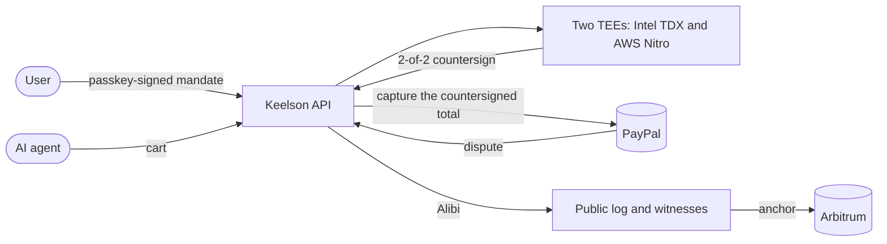

# Keelson

The liability layer for AI-agent purchases on PayPal. Keelson checks every purchase an agent makes
against what the user signed, before PayPal pays; seals each decision in an Alibi anyone can verify;
and makes the party at fault pay.

It is for the people an AI agent spends for: the user who signs a mandate, the merchant who ships,
and the operator who runs the agent and bonds it. Today, when an agent buys the wrong thing, nobody
can show who was at fault, and the user carries the loss.

- **Try it, no sign-up:** [Judge Mode](https://app.keelson.finance/judge)
- **Verify a real Alibi in one minute:** https://docs.keelson.finance/quickstart/verify-an-alibi/
- **Documentation:** https://docs.keelson.finance
- **Code:** this repository, Apache-2.0

> [!IMPORTANT]
> Payments run on the PayPal sandbox and the contracts on Arbitrum Sepolia, so no real money moves.
> The two TEEs, the public log and its witnesses, the monitor and the AI run in production. Every
> dependency and how to check it: [Real or sandbox](https://docs.keelson.finance/security/environments/).

## Verify it in one command

This sends a real Alibi, from a purchase paid on the PayPal sandbox, to the verifier:

```sh check=readme-verify
curl -sL https://raw.githubusercontent.com/DavidZapataOh/keelson-paypal/main/packages/alibi/test/fixtures/01M6ZWZJHWRRHQEYNJAT7NMSV8.alibi \
| curl -s https://api.keelson.finance/v1/alibis/verify \
    -H 'content-type: application/vnd.keelson.alibi.v1+json' \
    -H "idempotency-key: readme-$RANDOM$RANDOM" --data-binary @- \
| jq -r '"\(.verdict) \(.mode)"'
# expect: ^verified 2of2$
```

`verified 2of2` means both TEEs, Intel TDX and AWS Nitro, countersigned it, and each check passed:
the user's passkey, both attestations, inclusion in the public log, the witnesses, the anchor on
chain. To trust no Keelson server, drop the same file on https://verify.keelson.finance.

## How it works



1. **Mandate.** The user says what the agent may buy, where, for how much and until when. Two models
   draft the mandate, and the user signs the rendered card with a passkey. PayPal holds the budget.
2. **Countersign.** Before each payment, the same engine in two TEEs from two vendors checks the cart
   against the mandate with Cedar and signs ALLOW or DENY. Only an ALLOW is captured, for exactly
   the countersigned amount.
3. **Alibi.** Every decision is sealed with what the agent saw, appended to a public transparency log,
   cosigned by witnesses, co-logged in Sigsum and anchored on chain.
4. **Liability.** When a purchase is disputed, both TEEs attribute it with a fixed decision table: the
   operator's PYUSD bond is slashed, Keelson's reserve pays its warranty, or the Alibi goes to PayPal
   as evidence. PayPal adjudicates.

More: [How it works](https://docs.keelson.finance/concepts/how-it-works/) and the
[specification](https://docs.keelson.finance/reference/spec/).

## Verify it yourself

Each claim links to a command that checks it, and most also have a path that trusts no Keelson
server. The repository's tests run every one against production.

| Claim                                                                 | Check                                                                                                                                            |
| --------------------------------------------------------------------- | ------------------------------------------------------------------------------------------------------------------------------------------------ |
| The TEE image is reproducible, and leg B reports the committed digest | [TEE image](https://docs.keelson.finance/security/verify/#tee-image)                                                                             |
| Leg A is a genuine Intel TDX VM running that image                    | [Leg A](https://docs.keelson.finance/security/verify/#leg-a-tdx)                                                                                 |
| Leg B is a genuine AWS Nitro Enclave with the pinned measurement      | [Leg B](https://docs.keelson.finance/security/verify/#leg-b-nitro)                                                                               |
| Every decision, ALLOW or DENY, is in a public log                     | [Log](https://docs.keelson.finance/security/verify/#log-checkpoint)                                                                              |
| Witnesses cosign it, and Sigsum keeps a copy Keelson does not run     | [Witnesses](https://docs.keelson.finance/security/verify/#witnesses), [Sigsum](https://docs.keelson.finance/security/verify/#sigsum)             |
| Checkpoints are anchored on Arbitrum Sepolia                          | [Anchor](https://docs.keelson.finance/security/verify/#anchor)                                                                                   |
| The log's key is bonded, and an equivocation slashes it               | [Log bond](https://docs.keelson.finance/security/verify/#log-bond)                                                                               |
| The bond vault, reserve, verifiers and courts are deployed            | [Contracts](https://docs.keelson.finance/security/verify/#contracts), [ZK verifiers](https://docs.keelson.finance/security/verify/#zk-verifiers) |
| Payments run on the PayPal sandbox                                    | [PayPal](https://docs.keelson.finance/security/verify/#paypal-sandbox)                                                                           |
| A public monitor audits every leaf                                    | [Monitor](https://docs.keelson.finance/security/verify/#monitor)                                                                                 |

What an Alibi guarantees, and what it does not: [Threat model](https://docs.keelson.finance/security/threat-model/).

## PayPal and AI, exactly where

| What                                      | Where                                   | How it is used                                                             |
| ----------------------------------------- | --------------------------------------- | -------------------------------------------------------------------------- |
| PayPal Orders v2                          | `packages/paypal/src/hold.ts`           | Holds the mandate's budget; captures exactly the countersigned total       |
| PayPal Payments v2 refunds                | `packages/paypal/src/refunds.ts`        | Pays a verdict's refund, tagged with the verdict                           |
| PayPal Disputes                           | `packages/paypal/src/disputes.ts`       | Reads disputes and sends the Alibi as evidence                             |
| PayPal Webhooks                           | `packages/paypal/src/webhook-verify.ts` | Verified in-house, then re-read with an authenticated `GET`                |
| PayPal Payouts                            | `packages/paypal/src/payouts.ts`        | Pays a merchant when a verdict settles off chain                           |
| PayPal JavaScript SDK v6                  | `apps/store/src/pages.ts`               | The sandbox demo store's checkout                                          |
| Claude Opus 5.5, Sonnet 5.5 and Haiku 5.5 | `packages/compiler/src/compile.ts`      | Two models draft each mandate; a third checks the card against the request |
| Claude Sonnet 5.5 and a hosted browser    | `services/agent/src/agent.ts`           | The shopping agent that buys under a mandate                               |
| Claude Opus 5.5 and Haiku 5.5             | `services/api/src/disputes/drafter.ts`  | Drafts dispute evidence from the Alibi                                     |
| MCP                                       | `services/mcp/src/server.ts`            | Claude, ChatGPT and Cursor connect over OAuth 2.1                          |

Keelson also proposes the convention it uses in PayPal's fields as the open
[PayPal Agent Mandate Extension](https://docs.keelson.finance/reference/ks1/), with real test
vectors.

## Questions judges ask

### Why two TEEs?

One vendor's flaw should not be enough to forge a countersign. Every ALLOW needs a signature from an
Intel TDX VM and from an AWS Nitro Enclave, under two vendors' roots of trust. When leg B is down,
leg A signs alone, the result says `degraded`, and it waits a longer veto window on chain.

### What if both TEEs are compromised?

Then Keelson can sign a false countersign or verdict, which is why it is the top row of the
[threat model](https://docs.keelson.finance/security/threat-model/). Large slashes still wait a veto
window, the vault rate-limits them, the log keeps a public record a monitor audits, and the
zero-knowledge courts convict a mandate violation without trusting the TEEs at all.

### Isn't this PayPal Purchase Protection?

No. Purchase Protection covers an item that never arrived or differs from its description. An agent
that buys a correctly described item the user did not want falls outside it, and PayPal's terms make
the account holder responsible for what someone they authorized does. Keelson decides whether the
agent stayed within what the user signed, and if not, who pays. PayPal still adjudicates.

### How is this different from AP2 or ACP mandates?

Those protocols record what the user allowed. Keelson enforces it before the money moves: two TEEs
check every cart and only an ALLOW is captured. Afterwards it attributes a dispute with a fixed table
and pays from a bond or a reserve.

### Who pays, and how much?

It depends on the field that was wrong. A green field, which Keelson checks (amount, merchant,
deadline, quantity), is Keelson's error, and its reserve pays the warranty. An amber field, which the
operator attests (category, variant, return policy), slashes the operator's PYUSD bond. A gray field
is a subjective wish only the user can judge. Keelson is not insurance; the rules are in the
[specification](https://docs.keelson.finance/reference/spec/).

## Build on it

| Package                                                               | What it is                                                                                                                                                                                        |
| --------------------------------------------------------------------- | ------------------------------------------------------------------------------------------------------------------------------------------------------------------------------------------------- |
| [`@keelson-finance/sdk`](packages/sdk/README.md)                      | TypeScript client: typed errors, one idempotency key per call kept across retries, `npx keelson login`, and adapters for the Vercel AI SDK, OpenAI Agents SDK, LangChain and the Claude Agent SDK |
| [`keelson-finance`](packages/sdk-python/README.md)                    | The same client for Python (`import keelson`), blocking and asyncio                                                                                                                               |
| [`@keelson-finance/verifier`](packages/verify/README.md)              | Offline Alibi verifier and `keelson-verify` CLI, the code of verify.keelson.finance                                                                                                               |
| [`@keelson-finance/context`](packages/context/src/index.ts)           | Keelson Context Plugin: the SDK docs, every operation and its schema, over MCP at `https://api.keelson.finance/context/mcp`                                                                       |
| [Postman collection](openapi/postman/keelson.postman_collection.json) | Every developer operation, signed in with OAuth 2.0 and PKCE                                                                                                                                      |

The clients are written by hand; their types are generated from
[`openapi/keelson.public.json`](openapi/keelson.public.json), the developer subset of the API, and
CI fails if they drift. `app.keelson.finance/developers` walks from install to a verified
purchase and ticks each step as your code runs. From this repository:

```sh
pnpm install && pnpm turbo run build --filter=@keelson-finance/sdk... --filter=@keelson-finance/verifier...
node packages/sdk/dist/cli.js login
node packages/sdk/examples/quickstart.mjs
```

## Repository layout

```
.
├── apps/
│   ├── web/             The product (Next.js): mandates, approvals, agents, disputes, consoles, Judge Mode
│   ├── docs/            This documentation site, docs.keelson.finance
│   ├── verify/          The Alibi verifier, in the browser
│   ├── store/           RunFast, the demo merchant store (PayPal sandbox)
│   └── landing/         Marketing site
├── services/
│   ├── api/             Hono API: OAuth 2.1, countersign pipeline, PayPal, disputes, settlement, alerts
│   ├── mcp/             MCP server: tools, the Alibi MCP App, STDIO entry
│   ├── agent/           The shopping agent: Claude driving a hosted browser
│   ├── redteam/         Attack campaigns and the operator risk model
│   ├── log/             The Alibi transparency log (Tessera, Go)
│   ├── witness/         The log's witnesses
│   └── monitor/         A public log monitor anyone can run
├── engine/
│   ├── tee/             The engine both TEE legs run (Rust), its image and measurements
│   ├── policy/          Cedar policy set, attribution table, symcc proofs
│   ├── mandate/, canon/, core/   Rust ports of the mandate, cart canonicalization and primitives
│   └── tlsn/            TLSNotary sessions
├── circuits/            Noir circuits: c1, c2a, c2b, c3, c1c3, and the vectors circuit
├── contracts/           Foundry: bond vault, reserve, signer registry, anchor, courts, verifiers, log bond
├── packages/            Shared TypeScript: core, mandate, policy, paypal, alibi, attest, chain, log,
│                        evidence, relayer, timestamp, compiler, db, erc8004, ui
├── internal/            Go packages shared by the log and the monitor
├── openapi/             Generated OpenAPI 3.1 document
├── docs/                Pointers to the documentation site
├── .github/workflows/   CI, TEE image and verification, contracts verification, judge journey
├── compose.yaml         Local PostgreSQL and Valkey
└── render.yaml          Render blueprint
```

## Development

Judge Mode and the documentation need none of this; it is for running Keelson from source.

Requires Node.js 26.13.0 (see `.node-version`), pnpm 12.16.1, which Corepack installs from the
`packageManager` field, Docker, and the Rust toolchain pinned in `rust-toolchain.toml`. The log,
witness and monitor need Go (see `go.mod`); the contracts need Foundry; the circuits need Nargo 1.0.0
and Barretenberg `bb` 5.3.0 (`nargo test` in each of `circuits/*`, and each circuit's `build.sh`).

```sh
corepack enable
pnpm install
cp .env.example .env
docker compose up -d
pnpm build
pnpm migrate
pnpm test
cargo test
```

`pnpm lint` runs Biome, and `pnpm typecheck` runs the TypeScript compiler across the workspace.
`pnpm --filter @keelson/paypal test:sandbox` runs the PayPal suite against the PayPal sandbox and
needs sandbox credentials in `.env`. `go test ./...` runs the log, witness and monitor tests, and
`forge test` in `contracts/` the contract tests (see [contracts](contracts/README.md#commands)).

The demo store at https://store.keelson.finance sells as RunFast, a PayPal sandbox business
account: checkout runs the PayPal JavaScript SDK v6 against the sandbox, so no real money moves.
`KEELSON_LIVE=1 pnpm --filter @keelson/store exec vitest run test/checkout.live.test.ts` buys one
pair as the sandbox buyer (`PAYPAL_SANDBOX_BUYER_EMAIL` and `PAYPAL_SANDBOX_BUYER_PASSWORD`); set
`STORE_URL` to run it against a deployed store.

A card mandate's purchase runs end to end against the deployed app and API with
`pnpm --filter @keelson/api exec node scripts/card-demo.ts` (it needs the card issuer's sandbox
key; see [How it works](https://docs.keelson.finance/concepts/how-it-works/)).

## Security

The contracts are unaudited. Report vulnerabilities privately as described in
[contracts/SECURITY.md](contracts/SECURITY.md).

## License

Apache License 2.0. See [LICENSE](LICENSE).
