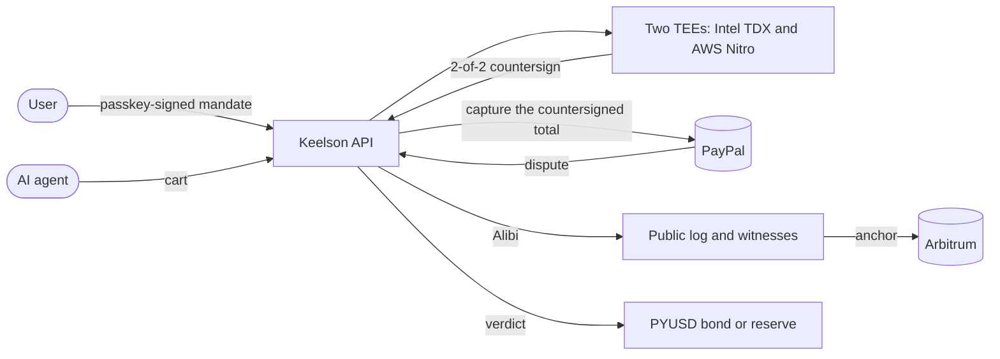

<p align="center"><picture><source media="(prefers-color-scheme: dark)" srcset=".github/assets/keelson-dark.svg"></picture></p>

<p align="center"><strong>Proof before payment for AI-agent purchases on PayPal.</strong></p>

Keelson checks every purchase an AI agent makes against what the user signed, before PayPal pays. It
seals each decision in an Alibi that anyone can verify, and when a purchase goes wrong it makes the
party at fault pay.

**[Try Judge Mode](https://app.keelson.finance/judge)** (no sign-up) ·
**[Verify an Alibi in one minute](https://docs.keelson.finance/quickstart/verify-an-alibi/)** ·
**[Docs](https://docs.keelson.finance)** · [Verifier](https://verify.keelson.finance) ·
[Status](https://app.keelson.finance/status) · [Red-team scoreboard](https://app.keelson.finance/scoreboard)

[](https://github.com/DavidZapataOh/keelson-paypal/actions/workflows/ci.yml)
[](packages/sdk/README.md)
[](https://pypi.org/project/keelson-finance/)
[](LICENSE)

> [!IMPORTANT]
> Payments run on the PayPal sandbox and the contracts on Arbitrum Sepolia, so no real money moves.
> The two TEEs, the public log and its witnesses, the monitor and the AI run in production. Every
> dependency and how to check it: [Real or sandbox](https://docs.keelson.finance/security/environments/).

## Who pays when an agent gets it wrong?

Today the user does. Visa's Core Rules make the cardholder responsible for an agent's purchase as if
the cardholder had made it. PayPal's Seller Protection for agent purchases covers unauthorized payments and
items that never arrived, so "the agent bought the wrong thing" falls outside it. The store sold
what it was asked for, and the agent's operator promises nothing.

Agents get it wrong often. In Visa's Agentic Commerce Benchmark (November 2026), 22 models failed
42.8% of shopping runs, and 54% of the failed runs still ended in a purchase. Keelson decides who
answers for each part of a purchase before the money moves, and proves it afterwards.

## How it works



1. **Mandate.** The user says what the agent may buy, where, for how much and until when. Claude
   drafts the mandate, and the user signs the rendered card with a passkey. PayPal holds the budget.
2. **Countersign.** Before each payment, the same Rust engine in two TEEs from two vendors checks the
   cart against the mandate with Cedar and signs ALLOW or DENY. No model takes part in this step.
   Only an ALLOW is captured, for exactly the countersigned amount.
3. **Alibi.** Every decision is sealed with what the agent saw, appended to a public transparency log,
   cosigned by witnesses, co-logged in Sigsum and anchored on chain. The Alibi is a SCITT receipt
   anyone can check offline.
4. **Liability.** When a purchase is disputed, both TEEs attribute it with a fixed decision table, and
   the party at fault pays. PayPal still adjudicates.

| What went wrong                                                 | Who pays                                   |
| --------------------------------------------------------------- | ------------------------------------------ |
| A field Keelson checks: amount, merchant, deadline, quantity    | Keelson, from its reserve                  |
| A field the operator attested: category, variant, return policy | The operator, whose PYUSD bond is slashed  |
| The store shipped something else                                | The store, through PayPal's normal dispute |
| A subjective wish, or a claim in bad faith                      | Nobody; the Alibi is the defense           |

More: [How it works](https://docs.keelson.finance/concepts/how-it-works/) and the
[specification](https://docs.keelson.finance/reference/spec/).

## Verify it in one command

This sends a real Alibi, from a purchase paid on the PayPal sandbox, to the verifier:

```sh check=readme-verify
curl -sL https://raw.githubusercontent.com/DavidZapataOh/keelson-paypal/main/packages/alibi/test/fixtures/01M6ZWZJHWRRHQEYNJAT7NMSV8.alibi \
| curl -s https://api.keelson.finance/v1/alibis/verify \
    -H 'content-type: application/vnd.keelson.alibi.v1+json' \
    -H "idempotency-key: readme-$RANDOM$RANDOM" --data-binary @- \
| jq -r '"\(.verdict) \(.mode)"'
# expect: ^verified 2of2$
```

`verified 2of2` means both TEEs, Intel TDX and AWS Nitro, countersigned it, and each check passed:
the user's passkey, both attestations, inclusion in the public log, the witnesses, the anchor on
chain. To trust no Keelson server, drop the same file on https://verify.keelson.finance, or run
`npx @keelson-finance/verifier alibi.json --chain` on your machine.

## PayPal and AI, exactly where

| What                                      | Where                                   | How it is used                                                                   |
| ----------------------------------------- | --------------------------------------- | -------------------------------------------------------------------------------- |
| PayPal Orders v2                          | `packages/paypal/src/hold.ts`           | Holds the mandate's budget as an authorization; captures the countersigned total |
| PayPal Vault                              | `packages/paypal/src/vault.ts`          | A saved PayPal account, so a mandate holds funds without a login window          |
| PayPal Webhooks                           | `packages/paypal/src/webhook-verify.ts` | Order, capture and dispute events drive the pipeline; verified, then re-read     |
| PayPal Disputes and refunds               | `packages/paypal/src/disputes.ts`       | Reads disputes, sends the Alibi as evidence, pays a verdict's refund             |
| PayPal Payouts                            | `packages/paypal/src/payouts.ts`        | Pays a merchant when a verdict settles off chain                                 |
| PYUSD                                     | `contracts/src/KeelsonBondVault.sol`    | Operators' bonds, slashed when an operator's attestation was false               |
| Claude Opus 5.5, Sonnet 5.5 and Haiku 5.5 | `packages/compiler/src/compile.ts`      | Two models draft each mandate; a third checks the card against the request       |
| Claude Sonnet 5.5 and a hosted browser    | `services/agent/src/agent.ts`           | The shopping agent: finds the item and drives checkout and PayPal                |
| Claude Opus 5.5 and Haiku 5.5             | `services/api/src/disputes/drafter.ts`  | Drafts dispute evidence from the Alibi and formats it for PayPal                 |
| MCP server                                | `services/mcp/src/server.ts`            | Claude, ChatGPT and Cursor request mandates and countersigns over OAuth 2.1      |

Claude decides what to buy, and the engine in the two TEEs decides whether the purchase is allowed,
so a prompt-injected or mistaken agent cannot spend outside the mandate. Keelson also
publishes the convention it uses in PayPal's fields as the open
[PayPal Agent Mandate Extension](https://docs.keelson.finance/reference/ks1/), with test vectors.

## Sponsor tools

| Tool                          | How Keelson uses it                                                                                                                                         |
| ----------------------------- | ----------------------------------------------------------------------------------------------------------------------------------------------------------- |
| Render                        | Hosts the API, workflows, prover, log, witness, demo store and every site from one [`render.yaml`](render.yaml) blueprint; deploys only after checks pass   |
| AG Grid, AG Studio, AG Charts | The merchant console is an AG Studio report whose assistant runs on Claude; the operator console's book is an AG Grid Enterprise grid with AG Charts        |
| KERNEL                        | The hosted Chromium the shopping agent drives, and the browser that captures the evidence an Alibi seals                                                    |
| Channel3                      | A live product lookup at decision time, compared field by field with what the agent saw and stored in the Alibi                                             |
| Postman                       | A [collection](openapi/postman/keelson.postman_collection.json) of every developer operation with OAuth 2.0 and PKCE, regenerated and run with Newman in CI |

## Verify it yourself

Each claim links to a command that checks it, and most also have a path that trusts no Keelson
server. The repository's tests run every one against production.

| Claim                                                                   | Check                                                                                                                                            |
| ----------------------------------------------------------------------- | ------------------------------------------------------------------------------------------------------------------------------------------------ |
| The TEE image is reproducible, and leg B reports the committed digest   | [TEE image](https://docs.keelson.finance/security/verify/#tee-image)                                                                             |
| Leg A is a genuine Intel TDX VM on Phala Cloud running that image       | [Leg A](https://docs.keelson.finance/security/verify/#leg-a-tdx)                                                                                 |
| Leg B is a genuine AWS Nitro Enclave with the pinned measurement        | [Leg B](https://docs.keelson.finance/security/verify/#leg-b-nitro)                                                                               |
| Every decision, ALLOW or DENY, is in a public log                       | [Log](https://docs.keelson.finance/security/verify/#log-checkpoint)                                                                              |
| Witnesses cosign it, and Sigsum keeps a copy Keelson does not run       | [Witnesses](https://docs.keelson.finance/security/verify/#witnesses), [Sigsum](https://docs.keelson.finance/security/verify/#sigsum)             |
| Checkpoints are anchored on Arbitrum Sepolia                            | [Anchor](https://docs.keelson.finance/security/verify/#anchor)                                                                                   |
| The log's key is bonded, and an equivocation slashes it                 | [Log bond](https://docs.keelson.finance/security/verify/#log-bond)                                                                               |
| The bond vault, reserve, Noir and SP1 verifiers and courts are deployed | [Contracts](https://docs.keelson.finance/security/verify/#contracts), [ZK verifiers](https://docs.keelson.finance/security/verify/#zk-verifiers) |
| Payments run on the PayPal sandbox                                      | [PayPal](https://docs.keelson.finance/security/verify/#paypal-sandbox)                                                                           |
| A public monitor audits every leaf                                      | [Monitor](https://docs.keelson.finance/security/verify/#monitor)                                                                                 |

Disputes can carry zero-knowledge proofs written in Noir, and an SP1 proof that the engine evaluated a
purchase correctly can veto an unfair slash. The red team runs 210 checkout attacks against the PayPal
sandbox (hidden fees, fake totals, look-alike payees, bidi and locale tricks, prompt injection); none
get through today, and the [scoreboard](https://app.keelson.finance/scoreboard) can be recomputed.
What an Alibi guarantees, and what it does not: [Threat model](https://docs.keelson.finance/security/threat-model/).

## Questions judges ask

### Why two TEEs?

One vendor's flaw should not be enough to forge a countersign. Every ALLOW needs a signature from an
Intel TDX VM and from an AWS Nitro Enclave, under two vendors' roots of trust. When leg B is down,
leg A signs alone, the result says `degraded`, and it waits a longer veto window on chain.

### What if both TEEs are compromised?

Then Keelson can sign a false countersign or verdict, which is why it is the top row of the
[threat model](https://docs.keelson.finance/security/threat-model/). Large slashes still wait a veto
window, the vault rate-limits them, the log keeps a public record a monitor audits, and the
zero-knowledge courts convict a mandate violation without trusting the TEEs at all.

### Isn't this PayPal Purchase Protection?

No. Purchase Protection covers an item that never arrived or differs from its description. An agent
that buys a correctly described item the user did not want falls outside it, and PayPal's terms make
the account holder responsible for what someone they authorized does. Keelson decides whether the
agent stayed within what the user signed, and if not, who pays. PayPal still adjudicates.

### How is this different from AP2 or ACP mandates?

Those protocols record what the user allowed. Keelson enforces it before the money moves: two TEEs
check every cart and only an ALLOW is captured. Afterwards it attributes a dispute with a fixed table
and pays from a bond or a reserve.

### Who pays, and how much?

It depends on the field that was wrong, as in the table above. A green field is Keelson's error and
its reserve pays a capped warranty. An amber field slashes the operator's PYUSD bond. A gray field is
a subjective wish only the user can judge. Keelson is not insurance; the rules are in the
[specification](https://docs.keelson.finance/reference/spec/).

## Build on it

```sh
npm install @keelson-finance/sdk @keelson-finance/verifier   # or: pip install keelson-finance
npx @keelson-finance/sdk login                               # passkey, or Judge Mode
claude mcp add --transport http keelson https://api.keelson.finance/mcp
```

| Package                                                     | What it is                                                                                                    |
| ----------------------------------------------------------- | ------------------------------------------------------------------------------------------------------------- |
| [`@keelson-finance/sdk`](packages/sdk/README.md)            | TypeScript client, with adapters for the Vercel AI SDK, OpenAI Agents SDK, LangChain and the Claude Agent SDK |
| [`keelson-finance`](packages/sdk-python/README.md)          | The same client for Python (`import keelson`), blocking and asyncio                                           |
| [`@keelson-finance/verifier`](packages/verify/README.md)    | Offline Alibi verifier and `keelson-verify` CLI, the code of verify.keelson.finance                           |
| [`@keelson-finance/context`](packages/context/src/index.ts) | The SDK docs and every operation's schema, over MCP at `https://api.keelson.finance/context/mcp`              |

The [SDK quickstart](packages/sdk/README.md#quickstart) requests a mandate, countersigns a cart and
verifies the Alibi in about 20 lines. The client types are generated from
[`openapi/keelson.public.json`](openapi/keelson.public.json), and CI fails if they drift.
`app.keelson.finance/developers` walks from install to a verified purchase.

## Run it from source

Judge Mode and the documentation need none of this. Requires Node.js 26.13.0 (see `.node-version`),
pnpm 12.16.1 (Corepack installs it from `packageManager`), Docker, and the Rust toolchain pinned in
`rust-toolchain.toml`. The log, witness and monitor need Go (see `go.mod`); the contracts need
Foundry; the circuits need Nargo 1.0.0 and Barretenberg `bb` 5.3.0.

```sh
corepack enable
pnpm install
cp .env.example .env    # PayPal sandbox and Anthropic credentials
docker compose up -d    # PostgreSQL and Valkey
pnpm build
pnpm migrate
pnpm test
cargo test
```

`pnpm lint` runs Biome and `pnpm typecheck` the TypeScript compiler. `pnpm --filter @keelson/paypal
test:sandbox` runs the PayPal suite against the sandbox. `go test ./...` runs the log, witness and
monitor tests, `forge test` in `contracts/` the [contract tests](contracts/README.md#commands), and
`nargo test` in each of `circuits/*` the circuits.

The demo store at https://store.keelson.finance sells as RunFast, a PayPal sandbox business account,
with checkout on the PayPal JavaScript SDK v6.

## Repository layout

```
apps/        web (product and Judge Mode), docs, verify, store (RunFast), landing
services/    api (Hono), mcp, agent (Claude + Kernel), redteam, log (Tessera, Go), witness, monitor
engine/      tee (the Rust engine both legs run), policy (Cedar), mandate, canon, core, tlsn, zkvm (SP1)
circuits/    Noir circuits: c1, c2a, c2b, c3, c1c3 and the vectors circuit
contracts/   Foundry: bond vault, reserve, signer registry, anchor, courts, verifiers, log bond
packages/    Shared TypeScript: core, mandate, policy, paypal, alibi, attest, chain, log, evidence,
             relayer, timestamp, compiler, db, erc8004, ui, sdk, sdk-python, verify, context
openapi/     OpenAPI 3.1 document and the Postman collection
render.yaml  Render blueprint
```

## Measured

Both TEE legs countersign in 31 ms at p95 from the API's host, excluding leg A's PayPal read; a full
`POST /v1/countersign` through both legs, PayPal and the database is 452 ms at p95. The engine's own
work is under 2 ms. Methods and budgets: [engine/tee](engine/tee/README.md) and
[services/api](services/api/README.md).

## Security

The contracts are unaudited. Report vulnerabilities privately as described in
[contracts/SECURITY.md](contracts/SECURITY.md).

## License

Keelson is open source under the [Apache License 2.0](LICENSE), an OSI-approved license.
