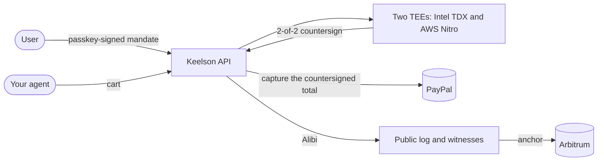

<p align="center"><picture><source media="(prefers-color-scheme: dark)" srcset=".github/assets/keelson-dark.svg"></picture></p>

<p align="center"><strong>Let your AI agent pay with PayPal, within limits your user signed.</strong></p>

Keelson is an API and SDK for agents that buy things. Your user signs a mandate once with a passkey.
Before each payment, two TEEs check the agent's cart against that mandate and countersign it, PayPal
captures only what was countersigned, and you get back an Alibi: a receipt anyone can verify offline.

[Docs](https://docs.keelson.finance) · [API reference](https://docs.keelson.finance/reference/api/) ·
[Verifier](https://verify.keelson.finance) · [Try it without code](https://app.keelson.finance/judge) ·
[Status](https://app.keelson.finance/status)

[](https://github.com/DavidZapataOh/keelson-paypal/actions/workflows/ci.yml)
[](packages/sdk/README.md)
[](https://pypi.org/project/keelson-finance/)
[](LICENSE)

> [!NOTE]
> The SDK quickstart runs on the PayPal sandbox and Arbitrum Sepolia. Live purchases at real stores
> use real PayPal accounts; they are listed at https://app.keelson.finance/live.

## Install

```sh
npm install @keelson-finance/sdk @keelson-finance/verifier   # or: pip install keelson-finance
npx @keelson-finance/sdk login                               # passkey, or Judge Mode with no sign-up
```

`login` opens your browser and saves the sign-in to `~/.config/keelson/credentials.json`, readable by
you only. There is no key to paste.

## Quickstart

Ask the user for a mandate, countersign a cart, and verify the Alibi.

```js
import { Keelson, quote } from "@keelson-finance/sdk";
import { verifyAlibi } from "@keelson-finance/verifier";

const keelson = new Keelson(); // signed in with `npx @keelson-finance/sdk login`
const req = await keelson.mandates.request({
  name: "Quickstart",
  reason:
    "I buy one pair of Pace Lite running shoes, size 10, at RunFast on the PayPal sandbox, and nothing else.",
  perPurchase: "$100",
  total: "$100",
  until: "1h",
});
console.log(`Approve with your passkey: ${req.approvalUrl}`);
const mandate = await keelson.mandates.waitForApproval(req.id);
const { cart, sources } = await quote([
  { productUrl: "https://store.keelson.finance/products/pace-lite", size: "10", qty: 1 },
]);
const { evidenceRoot } = await keelson.evidence.seal({
  mandateId: mandate.id,
  sources: { ...sources, observation: "Pace Lite, size 10, $99.00." },
});
const { purchaseId } = await keelson.purchases.countersign({ mandate, evidenceRoot, cart });
const purchase = await keelson.purchases.waitFor(purchaseId);
const report = await verifyAlibi(await keelson.alibis.retrieve(purchase.id));
console.log(`Bought ${purchase.id}. Alibi: ${report.verdict}`); // verified-offline
```

The same flow in Python:

```python
from keelson import Keelson, quote, verify_alibi

keelson = Keelson()  # signed in with `keelson login`
why = "I buy one pair of Pace Lite running shoes, size 10, at RunFast on the PayPal sandbox, and nothing else."
req = keelson.mandates.request(name="Quickstart", reason=why, per_purchase="$100", total="$100", until="1h")
print(f"Approve with your passkey: {req.approval_url}")
mandate = keelson.mandates.wait_for_approval(req.id)
q = quote([{"productUrl": "https://store.keelson.finance/products/pace-lite", "size": "10", "qty": 1}])
seen = {**q["sources"], "observation": "Pace Lite, size 10, $99.00."}
sealed = keelson.evidence.seal(mandate_id=mandate.id, sources=seen)
signed = keelson.purchases.countersign(mandate=mandate, evidence_root=sealed["evidenceRoot"], cart=q["cart"])
report = verify_alibi(keelson.alibis.retrieve(keelson.purchases.wait_for(signed.purchase_id).id))
```

Full method list, authentication for your own agents and framework adapters: the
[TypeScript SDK](packages/sdk/README.md) and the [Python SDK](packages/sdk-python/README.md).

## Connect an agent over MCP

```sh
claude mcp add --transport http keelson https://api.keelson.finance/mcp
```

Then run `/mcp` to sign in. The server is an OAuth 2.1 protected resource at
`https://api.keelson.finance/mcp`, so any MCP client that follows the resource metadata can connect.
The user approves each request with a passkey. Details:
[connect an agent](https://docs.keelson.finance/quickstart/connect-an-agent/).

## Verify an Alibi

This sends a real Alibi, from a purchase paid on the PayPal sandbox, to the verifier:

```sh check=readme-verify
curl -sL https://raw.githubusercontent.com/DavidZapataOh/keelson-paypal/main/packages/alibi/test/fixtures/01M6ZWZJHWRRHQEYNJAT7NMSV8.alibi \
| curl -s https://api.keelson.finance/v1/alibis/verify \
    -H 'content-type: application/vnd.keelson.alibi.v1+json' \
    -H "idempotency-key: readme-$RANDOM$RANDOM" --data-binary @- \
| jq -r '"\(.verdict) \(.mode)"'
# expect: ^verified 2of2$
```

`verified 2of2` means both TEEs, Intel TDX and AWS Nitro, countersigned it, and each check passed:
the user's passkey, both attestations, inclusion in the public log, the witnesses, the anchor on
chain. To trust no Keelson server, drop the same file on https://verify.keelson.finance, or run
`npx @keelson-finance/verifier alibi.json --chain` on your machine.

## How it works



- **Mandate.** What the agent may buy, where, for how much and until when, signed with the user's
  passkey. PayPal holds the budget (Orders v2 authorization, or a saved PayPal account through Vault).
- **Countersign.** The same Rust engine runs in both TEEs and checks the cart against the mandate with
  Cedar. No model takes part. Only an ALLOW is captured, for exactly the countersigned amount. If your
  agent pays on a store's own PayPal checkout, the pay click is held until PayPal's order or the
  user's passkey confirms the amount and payee.
- **Alibi.** Each decision is appended to a public transparency log, cosigned by witnesses and
  anchored on chain. The Alibi is an IETF SCITT transparent statement anyone can check offline.
- **Liability.** If a purchase is disputed, the fault is attributed field by field. A field Keelson
  checked is paid from Keelson's reserve; a field the agent's operator asserted is paid from the
  operator's PYUSD bond, which is slashed on chain.

Concepts and the full flow: [how it works](https://docs.keelson.finance/concepts/how-it-works/).
Trust model and what each party can and can't do: [threat model](https://docs.keelson.finance/security/threat-model/).

## Packages

| Package                                                     | What it is                                                                                                    |
| ----------------------------------------------------------- | ------------------------------------------------------------------------------------------------------------- |
| [`@keelson-finance/sdk`](packages/sdk/README.md)            | TypeScript client, with adapters for the Vercel AI SDK, OpenAI Agents SDK, LangChain and the Claude Agent SDK |
| [`keelson-finance`](packages/sdk-python/README.md)          | The same client for Python (`import keelson`), blocking and asyncio                                           |
| [`@keelson-finance/verifier`](packages/verify/README.md)    | Offline Alibi verifier and `keelson-verify` CLI, the code of verify.keelson.finance                           |
| [`@keelson-finance/context`](packages/context/src/index.ts) | The SDK docs and every operation's schema, over MCP at `https://api.keelson.finance/context/mcp`              |

The client types are generated from [`openapi/keelson.public.json`](openapi/keelson.public.json), and CI
fails if they drift. A [Postman collection](openapi/postman/) covers the same operations.

## Run it from source

Requires Node.js 26.13.0 (see `.node-version`), pnpm 12.16.1 (Corepack installs it from
`packageManager`), Docker, and the Rust toolchain pinned in `rust-toolchain.toml`. The log, witness
and monitor need Go (see `go.mod`); the contracts need Foundry; the circuits need Nargo 1.0.0 and
Barretenberg `bb` 5.3.0.

```sh
corepack enable
pnpm install
cp .env.example .env    # PayPal sandbox and Anthropic credentials
docker compose up -d    # PostgreSQL and Valkey
pnpm build
pnpm migrate
pnpm test
cargo test
```

`pnpm lint` runs Biome and `pnpm typecheck` the TypeScript compiler. `pnpm --filter @keelson/paypal
test:sandbox` runs the PayPal suite against the sandbox. `go test ./...` runs the log, witness and
monitor tests, `forge test` in `contracts/` the [contract tests](contracts/README.md#commands), and
`nargo test` in each of `circuits/*` the circuits. Every service deploys to Render from
[`render.yaml`](render.yaml).

## Repository layout

```
apps/        web (product and Judge Mode), docs, verify, store (RunFast), landing
services/    api (Hono), mcp, agent (Claude + Kernel), redteam, log (Tessera, Go), witness, monitor
engine/      tee (the Rust engine both legs run), policy (Cedar), mandate, canon, core, tlsn, zkvm (SP1)
circuits/    Noir circuits: c1, c2a, c2b, c3, c1c3 and the vectors circuit
contracts/   Foundry: bond vault, reserve, signer registry, anchor, courts, verifiers, log bond
packages/    Shared TypeScript: core, mandate, policy, paypal, alibi, attest, chain, log, evidence,
             relayer, timestamp, compiler, db, erc8004, ui, sdk, sdk-python, verify, context
openapi/     OpenAPI 3.1 document and the Postman collection
render.yaml  Render blueprint
```

## Built with

PayPal Orders v2, Vault, webhooks, the Disputes API, Payouts and PYUSD carry every payment and bond.
Claude (Anthropic) is the shopping agent, compiles mandates from plain language, drafts dispute
responses and powers the merchant console's assistant. The product runs on Render; the merchant
and operator consoles use AG Grid, AG Charts and AG Studio; the agent browses stores in KERNEL;
product data comes from Channel3; and the API ships with a Postman collection. Where each one is
used: [environments](https://docs.keelson.finance/security/environments/).

## Measured

Both TEE legs countersign in 31 ms at p95 from the API's host, excluding leg A's PayPal read; a full
`POST /v1/countersign` through both legs, PayPal and the database is 452 ms at p95. The engine's own
work is under 2 ms. Methods and budgets: [engine/tee](engine/tee/README.md) and
[services/api](services/api/README.md).

## Security

The contracts are unaudited. Report vulnerabilities privately as described in
[contracts/SECURITY.md](contracts/SECURITY.md).

## License

Keelson is open source under the [Apache License 2.0](LICENSE), an OSI-approved license.
