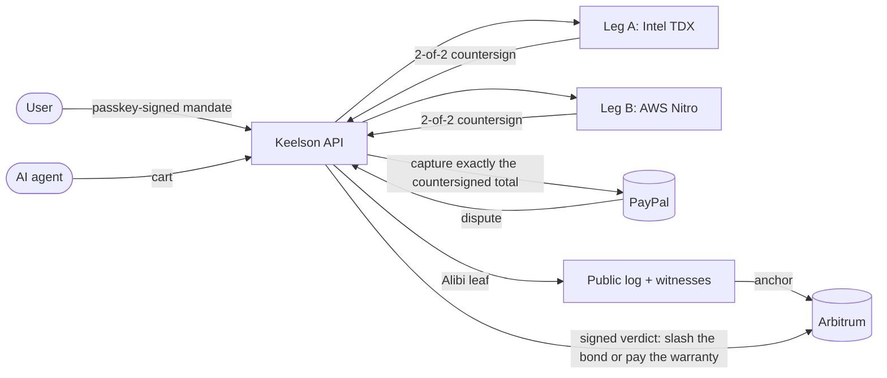

# Keelson

The liability layer for AI-agent purchases on PayPal. Keelson checks every purchase against what the
user signed before it is paid, seals it with an Alibi anyone can verify, and makes the party at
fault pay.

- **Product:** https://app.keelson.finance ([Judge Mode](https://app.keelson.finance/judge), no sign-up)
- **Verifier:** https://verify.keelson.finance
- **Status:** https://app.keelson.finance/status
- **Demo store:** https://store.keelson.finance
- **Transparency log:** https://log.keelson.finance/alibi/2026-1/checkpoint
- **MCP server:** `https://api.keelson.finance/mcp`

Payments run on the PayPal sandbox and the contracts on Arbitrum Sepolia. The TEEs, the log, its
witnesses and the AI run in production. [What is real and what is sandbox](docs/environments.md).

## How it works



1. **Mandate.** The user says what the agent may buy, where, for how much and until when. Two
   models draft the mandate, and the user signs the rendered card with a passkey. PayPal holds the
   budget.
2. **Countersign.** Before each payment, the same engine in two TEEs from two vendors checks the
   cart against the mandate with Cedar and signs ALLOW or DENY. Only an ALLOW is captured, for
   exactly the countersigned amount.
3. **Alibi.** Every decision is sealed with what the agent saw, appended to a public transparency
   log, cosigned by witnesses, co-logged in Sigsum and anchored on chain. Anyone can verify it in the
   browser.
4. **Liability.** When a purchase is disputed, the TEEs attribute it with a proven decision table:
   the operator's PYUSD bond is slashed, Keelson's reserve pays its warranty, or the Alibi goes to
   PayPal as evidence for the merchant or the user. PayPal adjudicates.

## What is live, and how to check it

| Claim                                                                                                                                          | Check                                                                                                                                                     |
| ---------------------------------------------------------------------------------------------------------------------------------------------- | --------------------------------------------------------------------------------------------------------------------------------------------------------- |
| Both TEE legs run the same reproducible image, `sha256:62dcd6071507130db485c5fa67bd371fc28188310cf83d82fdb9b7e22341b8cd`                       | `curl https://tee-b.keelson.finance/v1/health`; [`engine/tee/measurements.json`](engine/tee/measurements.json); rebuild with `make -C engine/tee measure` |
| Leg A is Intel TDX on Phala Cloud, measurement `tdx:ccdbe1020654595759c24698591df8025d3385f079d4c0e4e73770b3a73fe62f`                          | The `tee-verify` workflow checks its quote against Intel's collateral and replays its event log                                                           |
| Leg B is an AWS Nitro Enclave, measurement `nitro:1348a25408d15f524f289e75b0bd9301e7a28575113fc29087e4c03d1da9c9b7` (PCR0 `2c77e9fb…6f442400`) | `curl https://tee-b.keelson.finance/v1/attestation`                                                                                                       |
| Every countersign, ALLOW or DENY, is in a public log with a 2-of-3 witness quorum                                                              | `curl https://log.keelson.finance/alibi/2026-1/checkpoint`; [services/log](services/log/README.md)                                                        |
| Checkpoints are co-logged in Sigsum and anchored on Arbitrum Sepolia                                                                           | [`sigsum-verify`](services/log/README.md#sigsum); [`cast call` on `CheckpointAnchor`](services/log/README.md#anchors)                                     |
| The log's key is bonded and an equivocation slashes it on chain                                                                                | `curl https://api.keelson.finance/v1/log/bonds`; a drill slashed the conformance log's bond                                                               |
| A public monitor audits every leaf                                                                                                             | https://keelson-monitor-production.up.railway.app/report                                                                                                  |
| Disputes are attributed by both TEEs and settled on chain                                                                                      | Judge Mode, step "dispute"; [Dispute evaluation](services/api/README.md#dispute-evaluation)                                                               |
| ZK: C1, C2a, C2b, C3 and C1+C3 verify on chain                                                                                                 | [Deployments](contracts/README.md#deployments)                                                                                                            |
| Card mandates pay card merchants through single-use cards funded by a PayPal hold                                                              | [Card mandates](docs/architecture.md#card-mandates)                                                                                                       |
| Hosts (claude.ai, ChatGPT, Cursor) act for a user over OAuth; approvals can be signed in their frame                                           | [Apps acting for a user](services/api/README.md#apps-acting-for-a-user)                                                                                   |
| One click stops every agent; push and email alerts                                                                                             | [Agents and hosts](docs/architecture.md#agents-and-hosts)                                                                                                 |

**In progress:** an SP1 proof of the engine's evaluation for disputes, currency conversion in the
live checkout, and the Arbitrum One deployment. See [environments](docs/environments.md#in-progress).

## Documentation

| Document                                                                 | What it covers                                                                       |
| ------------------------------------------------------------------------ | ------------------------------------------------------------------------------------ |
| [Specification](docs/spec.md)                                            | Mandates, policy, countersign, evidence, Alibi, log, PayPal, contracts, disputes, ZK |
| [Architecture](docs/architecture.md)                                     | Components, purchase, dispute and card flows, trust anchors, hosting                 |
| [Threat model](docs/threat-model.md)                                     | Attacks, defenses and the limits stated plainly                                      |
| [Environments](docs/environments.md)                                     | What is real, what is sandbox, what is in progress                                   |
| [PayPal Agent Mandate Extension](docs/paypal-agent-mandate-extension.md) | The open `ks1.` convention for tagging agent payments on PayPal                      |
| [OpenAPI](openapi)                                                       | The API's OpenAPI 3.1 document                                                       |
| [Agent skill](apps/landing/public/skill.md)                              | How an agent connects and buys through MCP                                           |

Each component's README is its detailed reference: [engine/tee](engine/tee/README.md),
[engine/policy](engine/policy/README.md), [services/api](services/api/README.md),
[services/log](services/log/README.md), [services/monitor](services/monitor/README.md),
[contracts](contracts/README.md), [apps/verify](apps/verify/README.md),
[packages/evidence](packages/evidence/README.md), [packages/mandate](packages/mandate/README.md).

## Judge Mode

https://app.keelson.finance/judge opens a temporary tenant with one click (no keys, no sign-up)
and walks through the product in nine steps: a real mandate, the agent run that bought under it
and the injected run Keelson blocked, its Alibi in the verifier, a PayPal sandbox dispute with its
signed verdict and settlement, the demo merchant's console (read only), the operator's grade, the
red-team scoreboard and live status. A judge can ask the merchant console's assistant questions on
its own budget; it changes nothing, and the nightly reset closes the tenant after 12 hours.

`JUDGE_LIVE_ORIGIN=https://app.keelson.finance pnpm --filter @keelson/web exec vitest run test/e2e/judge.live.test.ts`
runs the judge's journey on production from a clean browser; `.github/workflows/judge-journey.yml`
runs it every hour and opens an issue when it fails.

## MCP server

Keelson's MCP server is served by the API at `https://api.keelson.finance/mcp` (Streamable HTTP,
stateless). It is an OAuth 2.1 protected resource: clients find the authorization server at
`/.well-known/oauth-protected-resource`. An agent's own client gets a token with the client
credentials grant for the resource `https://api.keelson.finance`; a host acting for a user
(claude.ai, ChatGPT, Cursor) registers itself and gets one with the authorization code grant, and
buys under the mandates the user approves for it (see
[the API's README](services/api/README.md#apps-acting-for-a-user)). Each tool asks for the scope
its API calls need. `keelson.get_alibi` renders the Alibi as an MCP App.

Closing a mandate for a countersign takes the agent's own key, which Keelson never holds, so
`keelson.request_countersign` is offered by the STDIO server, run as the agent's process. For
Claude Desktop, after `pnpm install && pnpm build`, add to `claude_desktop_config.json`:

```json
{
  "mcpServers": {
    "keelson": {
      "command": "node",
      "args": ["/path/to/keelson/services/mcp/dist/stdio.js"],
      "env": {
        "KEELSON_CLIENT_ID": "…",
        "KEELSON_CLIENT_SECRET": "…",
        "KEELSON_AGENT_KEY": "{\"kty\":\"EC\",…}",
        "AGENT_ID": "351"
      }
    }
  }
}
```

The OAuth client needs `countersign:write`, `evidence:write` and `alibis:read`, and must be the one
that linked the operator (`POST /v1/operators`). `KEELSON_AGENT_KEY` is the private P-256 JWK of
the `cnf` key mandates name. The MCP Inspector runs the same server with
`npx @modelcontextprotocol/inspector node services/mcp/dist/stdio.js`.

## Repository layout

```
.
├── apps/
│   ├── web/             The product (Next.js): mandates, approvals, agents, disputes, consoles, Judge Mode
│   ├── verify/          The Alibi verifier, in the browser
│   ├── store/           RunFast, the demo merchant store (PayPal sandbox)
│   └── landing/         Marketing site
├── services/
│   ├── api/             Hono API: OAuth 2.1, countersign pipeline, PayPal, disputes, settlement, alerts
│   ├── mcp/             MCP server: tools, the Alibi MCP App, STDIO entry
│   ├── agent/           The shopping agent: Claude driving a hosted browser
│   ├── redteam/         Attack campaigns and the operator risk model
│   ├── log/             The Alibi transparency log (Tessera, Go)
│   ├── witness/         The log's witnesses
│   └── monitor/         A public log monitor anyone can run
├── engine/
│   ├── tee/             The engine both TEE legs run (Rust), its image and measurements
│   ├── policy/          Cedar policy set, attribution table, symcc proofs
│   ├── mandate/, canon/, core/   Rust ports of the mandate, cart canonicalization and primitives
│   └── tlsn/            TLSNotary sessions
├── circuits/            Noir circuits: c1, c2a, c2b, c3, c1c3, and the vectors circuit
├── contracts/           Foundry: bond vault, reserve, signer registry, anchor, courts, verifiers, log bond
├── packages/            Shared TypeScript: core, mandate, policy, paypal, alibi, attest, chain, log,
│                        evidence, relayer, timestamp, compiler, db, erc8004, ui
├── internal/            Go packages shared by the log and the monitor
├── openapi/             Generated OpenAPI 3.1 document
├── docs/                Specification, architecture, threat model, environments, PayPal extension
├── .github/workflows/   CI, TEE image and verification, contracts verification, judge journey
├── compose.yaml         Local PostgreSQL and Valkey
└── render.yaml          Render blueprint
```

## Development

Requires Node.js 26.13.0 (see `.node-version`), pnpm 12.16.1, which Corepack installs from the
`packageManager` field, Docker, and the Rust toolchain pinned in `rust-toolchain.toml`. The log,
witness and monitor need Go (see `go.mod`); the contracts need Foundry; the circuits need Nargo 1.0.0
and Barretenberg `bb` 5.3.0 (`nargo test` in each of `circuits/*`, and each circuit's `build.sh`).

```sh
corepack enable
pnpm install
cp .env.example .env
docker compose up -d
pnpm build
pnpm migrate
pnpm test
cargo test
```

`pnpm lint` runs Biome, and `pnpm typecheck` runs the TypeScript compiler across the workspace.
`pnpm --filter @keelson/paypal test:sandbox` runs the PayPal suite against the PayPal sandbox and
needs sandbox credentials in `.env`. `go test ./...` runs the log, witness and monitor tests, and
`forge test` in `contracts/` the contract tests (see [contracts](contracts/README.md#commands)).

The demo store at https://store.keelson.finance sells as RunFast, a PayPal sandbox business
account: checkout runs the PayPal JavaScript SDK v6 against the sandbox, so no real money moves.
`KEELSON_LIVE=1 pnpm --filter @keelson/store exec vitest run test/checkout.live.test.ts` buys one
pair as the sandbox buyer (`PAYPAL_SANDBOX_BUYER_EMAIL` and `PAYPAL_SANDBOX_BUYER_PASSWORD`); set
`STORE_URL` to run it against a deployed store.

A card mandate's purchase runs end to end against the deployed app and API with
`pnpm --filter @keelson/api exec node scripts/card-demo.ts` (it needs the card issuer's sandbox
key; see [Card mandates](docs/architecture.md#card-mandates)).

## Security

The contracts are unaudited. Report vulnerabilities privately as described in
[contracts/SECURITY.md](contracts/SECURITY.md).

## License

Apache License 2.0. See [LICENSE](LICENSE).
