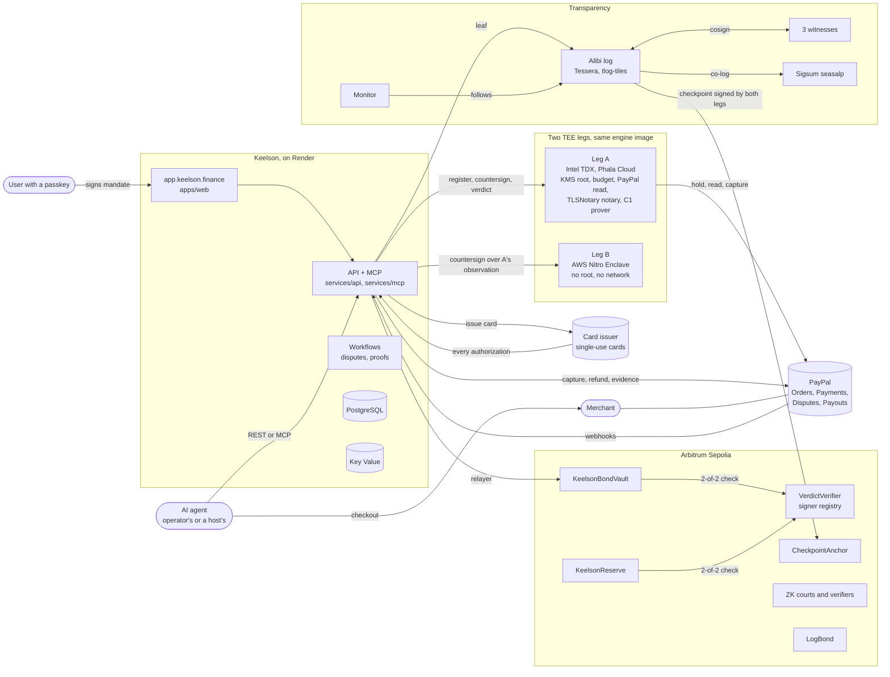
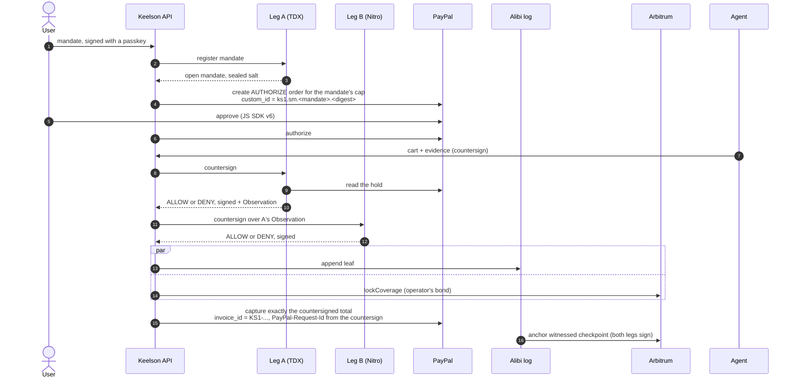
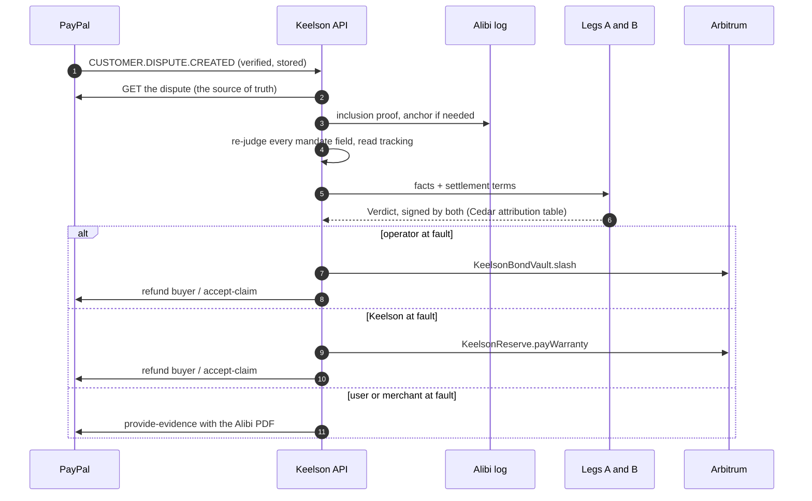
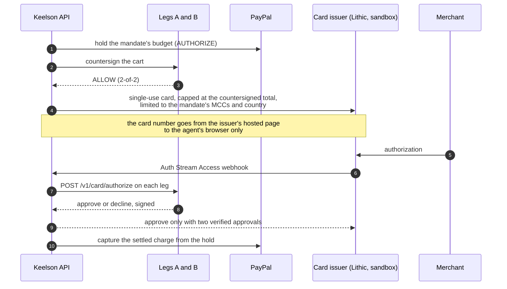

# Architecture

Keelson sits between an AI agent and the payment. The user signs a mandate with a passkey; every
cart the agent wants to pay is checked against it by the same engine running in two TEEs from two
vendors; each decision is sealed into an Alibi and appended to a public transparency log; and when a
purchase is disputed, the engine names the party at fault and the chain moves the money. This page
shows how the parts fit. Each component's README has the details.

## System

## Components

| Path                                            | What it is                                                                                                                                                         |
| ----------------------------------------------- | ------------------------------------------------------------------------------------------------------------------------------------------------------------------ |
| `apps/web`                                      | The product at `app.keelson.finance`: mandates, approvals, agents, disputes, merchant and operator consoles, Judge Mode, status                                    |
| `apps/verify`                                   | The Alibi verifier at `verify.keelson.finance`. Runs entirely in the browser against pinned trust roots                                                            |
| `apps/store`                                    | RunFast, the demo merchant at `store.keelson.finance` (PayPal sandbox)                                                                                             |
| `apps/landing`                                  | The marketing site at `keelson.finance`                                                                                                                            |
| `services/api`                                  | Hono API: OAuth 2.1, mandates, countersign pipeline, PayPal holds and captures, webhooks, disputes, settlement, alerts                                             |
| `services/mcp`                                  | MCP server, served by the API at `/mcp` and as a STDIO process for agents that hold their own key                                                                  |
| `services/agent`                                | The shopping agent: Claude driving a Kernel browser, with a gate that holds the pay click until Keelson countersigns                                               |
| `services/redteam`                              | Attack campaigns against the agent and the risk model that grades operators                                                                                        |
| `services/log`                                  | The Alibi log, a Tessera personality                                                                                                                               |
| `services/witness`                              | The log's witnesses (litewitness)                                                                                                                                  |
| `services/monitor`                              | A public log monitor that anyone can run                                                                                                                           |
| `engine/tee`                                    | The engine both TEE legs run: mandate registration, countersign, verdicts, card authorizations, checkpoint signing, TLSNotary                                      |
| `engine/policy`                                 | The Cedar policy set, the attribution table and their symcc proofs                                                                                                 |
| `engine/mandate`, `engine/canon`, `engine/core` | Rust ports of the mandate, cart canonicalization and core primitives, pinned to the TypeScript side by shared vectors                                              |
| `engine/tlsn`                                   | TLSNotary sessions over public product endpoints                                                                                                                   |
| `circuits/`                                     | Noir circuits C1, C2a, C2b, C3 and C1+C3                                                                                                                           |
| `contracts/`                                    | Bond vault, reserve, signer registry, checkpoint anchor, ZK courts and verifiers, log bond, ERC-8004 integration                                                   |
| `packages/`                                     | Shared TypeScript: `core`, `mandate`, `policy`, `paypal`, `alibi`, `attest`, `chain`, `log`, `evidence`, `relayer`, `timestamp`, `compiler`, `db`, `erc8004`, `ui` |
| `internal/`                                     | Go packages shared by the log and the monitor                                                                                                                      |

## A purchase

A DENY is signed and logged too, and nothing is captured. The full state machine
(`COUNTERSIGNED → LOGGED → COVERED → CAPTURED`) is in
[the API's README](../services/api/README.md#purchase-pipeline).

When leg B is unreachable the API countersigns with leg A alone and says so: `mode: "degraded"` in
the body, `Keelson-Countersign-Mode: degraded` in the header and in the log leaf. On chain, a
degraded coverage's slash waits a longer veto window.

## A dispute

PayPal adjudicates the dispute. Keelson's verdict decides what evidence is sent, who is slashed and
whether the warranty pays; it does not bind PayPal. Details in
[Dispute evaluation](../services/api/README.md#dispute-evaluation).

Two courts convict on chain:

- **C2a, `MandateViolationCourt`**: anyone holding the mandate's opening proves the countersigned
  cart broke the mandate. This path does not trust Keelson's TEEs.
- **C2b, `AmberContradictionCourt`**: the store's own TLS response, notarized with TLSNotary,
  contradicts what the operator attested about the item. The notary is leg A, so this path trusts
  Keelson's TDX leg.
- **`ViolationBondPool`** pays a conviction from either court out of the operator's deposit.

## Card mandates

A mandate signed for "Any store (PayPal card)" pays merchants that take cards rather than PayPal.

The Alibi carries the card, every authorization with both legs' signed answers, and the settlement.
A chargeback goes through the issuer's disputes API with the Alibi as evidence. In this deployment the
issuer is Lithic's sandbox, which also plays the card network.

## Agents and hosts

- **An operator's own agent** gets a token with the OAuth client credentials grant and closes each
  mandate for a countersign with its own P-256 key, which Keelson never holds. The STDIO MCP server
  runs in the agent's process for that reason.
- **A host acting for a user** (claude.ai, ChatGPT, Cursor, Claude Code) registers itself
  (RFC 7591), gets a user-bound token with the authorization code grant and PKCE, and buys only
  under mandates the user approved for that host. Without an operator of its own it acts through
  Keelson's hosted operator, whose bond covers it, under per-user and total exposure caps. See
  [Apps acting for a user](../services/api/README.md#apps-acting-for-a-user).
- **In-frame signing.** An agent platform can frame Keelson's approval. The passkey assertion then
  comes from `https://api.keelson.finance` with `crossOrigin: true`, and its `topOrigin` must equal
  the `embed.top_origin` the signed payload carries, so a mandate signed in one platform's frame
  cannot be replayed as signed in another. The frame asks for Secure Payment Confirmation and falls
  back to a plain WebAuthn assertion.
- **Kill switch.** `POST /v1/agents/stop` refuses every countersign under the user's existing
  mandates, revokes live mandates and voids their PayPal holds, denies open requests, revokes every
  agent's OAuth grant and logs the stop as a `keelson.finance/stop/v1` leaf. Purchases already
  countersigned may still be captured.
- **Alerts.** Web Push (VAPID, RFC 8292) and email tell the user when an app asks for a mandate or
  a change, a purchase is captured or blocked, or agents were stopped.

## Trust anchors

| What             | Anchored in                                                                                                                                                                              |
| ---------------- | ---------------------------------------------------------------------------------------------------------------------------------------------------------------------------------------- |
| The engine build | A reproducible image (`ghcr.io/davidzapataoh/keelson-engine`), built twice on separate runners and required to match                                                                     |
| Leg A's identity | TDX measurement id: MRTD, RTMR0-2, app id, compose hash, OS image hash                                                                                                                   |
| Leg B's identity | Nitro PCR0-2 of the enclave image built from the same digest                                                                                                                             |
| A signer         | `VerdictVerifier`: registered from a fresh attestation whose `report_data` binds the signer, the chain, the bond vault, the policy set, the build and a recent block; active 72 h        |
| The log          | Ed25519 and ML-DSA-44 log keys, a 2-of-3 witness quorum, Sigsum co-logging, on-chain anchors signed by both legs, and a `LogBond` that anyone can slash with two conflicting checkpoints |
| The policy       | The Cedar policy set's hash, bound into every countersign and attestation; symcc proofs attested on `main`                                                                               |

The current image and measurements are in [`engine/tee/measurements.json`](../engine/tee/measurements.json)
and can be rebuilt from source with `make -C engine/tee measure`. See
[Reproduce the measurements](../engine/tee/README.md#reproduce-the-measurements).

## Hosting

| Part                                                                                 | Where                                                                     |
| ------------------------------------------------------------------------------------ | ------------------------------------------------------------------------- |
| API, workflows, web, verifier, store, landing, log, witness 1, PostgreSQL, Key Value | Render, Oregon (`render.yaml`)                                            |
| Leg A                                                                                | Phala Cloud, Intel TDX `tdx.small`, dstack 0.6.1                          |
| Leg B                                                                                | AWS EC2 `c6a.xlarge` in `us-west-2`, Nitro Enclave with 2 vCPUs and 1 GiB |
| Witness 2, monitor                                                                   | Railway                                                                   |
| Witness 3                                                                            | AWS EC2, `us-west-2`                                                      |
| Contracts                                                                            | Arbitrum Sepolia                                                          |
